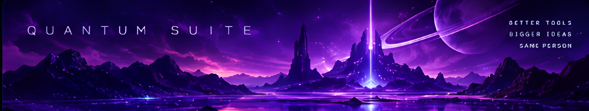
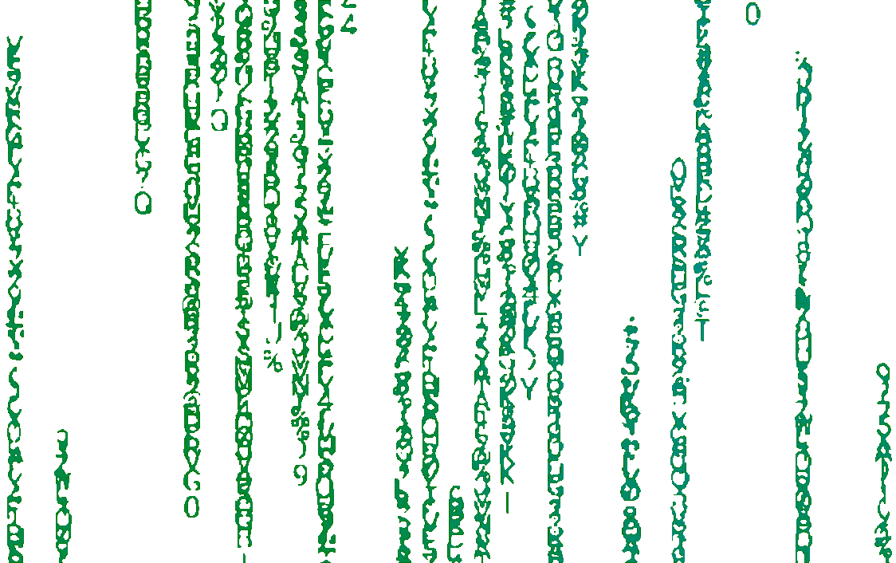
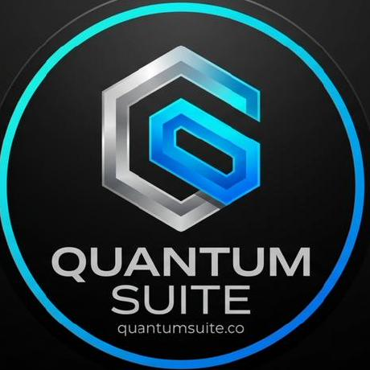

<div align="center">
  

  <h1>Hey, welcome to my corner of GitHub ✦</h1>
  <p><em>I build things, experiment with ideas, and learn by making.</em></p>

  <a href="https://github.com/Ai-finder-for-api"></a>
  
</div>

---

I like turning a question into something real: a small experiment becomes a tool, a tool becomes a project, and the project opens up a dozen new things to explore. Most of my interests sit around **systems programming, Python tooling, AI agents, creative software, graphics, and developer experience**.

This profile is a tour of the things I enjoy building—not a product landing page or a list of claims that everything is finished. Some projects are long-term efforts; others are experiments that taught me something useful.


<p align="center">
  
</p>

<p align="center"><sub>GIF preview · <a href="assets/gifs/gif.gif">Open the original file ↗</a></sub></p>


## ✦ GitHub activity

<p align="center">
  
  
</p>
<p align="center">
  
</p>

<sub>These community-hosted cards may be cached or temporarily unavailable. They are a snapshot, not a scoreboard.</sub>

## ✦ What I'm working on

<table>
<tr>
<td width="50%" valign="top">
  <h3>🌌 Quantum Suite</h3>
  <p>A growing ecosystem of developer tools, systems components, graphics work, and creative-software ideas. I enjoy working from the foundations upward and seeing what those building blocks make possible.</p>
  <p><a href="https://quantumsuite.pages.dev/">Visit the website ↗</a> · <a href="https://github.com/Quantum-Suite-org">Explore the organization ↗</a></p>
</td>
<td width="50%" valign="top">
  <h3>🪶 Falcon Hub MCP</h3>
  <p>Tools and workflows that help AI assistants work with real development tasks, utilities, and files—not just describe what someone could do next.</p>
</td>
</tr>
<tr>
<td width="50%" valign="top">
  <h3>🧰 Python utilities</h3>
  <p>Small command-line tools for inspecting repositories, validating data, checking links, automating repetitive tasks, and making project maintenance less tedious.</p>
</td>
<td width="50%" valign="top">
  <h3>🧪 Experiments & side quests</h3>
  <p>UI prototypes, graphics, build systems, package-management ideas, game-related tools, and little experiments that start with “could this work?”</p>
</td>
</tr>
</table>

## ✦ A closer look at Quantum Suite

Quantum Suite is one of my projects, not the whole story. The bigger idea is to explore how useful low-level components and developer tools can grow into creative applications.

<p align="center">
  <a href="assets/videos/video.mp4"></a>
  <br />
  <sub><a href="https://quantumsuite.pages.dev/">Visit the website ↗</a> · <a href="assets/videos/video.mp4">Open the project video ↗</a></sub>
</p>

GitHub may display repository video files differently depending on the client, so the link opens the actual video file rather than pretending this is a custom embedded player.

## ✦ Projects worth exploring

<p align="center">
  <a href="https://github.com/Ai-finder-for-api/engine-v1"></a>
  <a href="https://github.com/Ai-finder-for-api/easy-vulkan-gui"></a>
  <a href="https://github.com/Ai-finder-for-api/math-basic"></a>
  <a href="https://github.com/Quantum-Suite-org/qs_math"></a>
  <a href="https://github.com/Quantum-Suite-org/qs_build"></a>
  <a href="https://github.com/Quantum-Suite-org/quantum-vault"></a>
</p>

## ✦ Languages, tools & interests

<p align="center">
  
</p>

- **C++ and systems:** modular libraries, architecture, graphics APIs, build tooling, and understanding what happens beneath the surface.
- **Python:** CLI utilities, filesystem inspection, JSON validation, small automation scripts, test helpers, and glue between tools.
- **JavaScript and TypeScript:** developer utilities, integrations, interfaces, and scripting.
- **AI and MCP:** tool discovery, structured tool interfaces, workflows, and making assistants useful in real development environments.
- **Creative technology:** graphics, media, interactive experiences, and software that is interesting to use.
- **Engineering habits:** reproducible tests, explicit failure handling, readable diagnostics, and honest descriptions of what has actually been verified.

## ✦ A little more Python

Python is especially useful when I need a practical tool quickly: something that checks a project, makes repetitive work easier, or produces a clear report without adding a large dependency chain.

This repository includes a standard-library-oriented project toolbox at `scripts/project_toolbox.py`. It provides commands for common inspection tasks:

| Command | What it does |
| --- | --- |
| `inventory` | Summarizes file counts, extensions, total size, and largest files. |
| `duplicates` | Finds byte-identical files for review; it does not delete them. |
| `json` | Checks whether JSON files parse correctly. |
| `text` | Reports line, word, and character counts for text files. |
| `tree` | Prints a readable directory tree with a depth limit. |
| `large` | Finds files above a chosen size threshold. |
| `markdown` | Checks relative Markdown links for missing local targets. |
| `secrets` | Flags common token-like patterns for manual review without printing matched values. |

Example commands from the repository root:

```bash
python scripts/project_toolbox.py inventory .
python scripts/project_toolbox.py tree . --depth 3
python scripts/project_toolbox.py json .
python scripts/project_toolbox.py duplicates .
python scripts/project_toolbox.py markdown .
python scripts/project_toolbox.py large . --min-bytes 1000000
python scripts/project_toolbox.py secrets .
```

The toolbox is meant to make routine checks quick and understandable. A heuristic secret scan is not a security guarantee; JSON parsing does not validate an application's schema; and a local link check cannot promise that external links are still online. Tools are most useful when their limits are clear.

More generally, the Python things I like building tend to follow a few rules:

- **Useful defaults:** make the common task easy to run.
- **Read-only first:** inspection should not silently change the files being inspected.
- **Actionable errors:** tell me what failed and where, without leaking sensitive content.
- **Small dependencies:** use the standard library when it is enough.
- **Repeatability:** the same inputs should produce understandable, comparable results.
- **Real tests:** include awkward paths, empty files, malformed input, and failure cases—not just the happy path.
- **Honest reporting:** say what was checked instead of claiming a tool proves more than it can.

## ✦ How I like to build

- Start with a real question, not a pile of abstractions.
- Keep components separate when the boundary makes them easier to understand, test, or reuse.
- Prefer evidence over guesswork: reproduce the issue, inspect the output, and test the change.
- Make tools explain their failures instead of hiding them behind a vague “something went wrong.”
- Treat security checks as useful signals, not magic guarantees.
- Keep interfaces clear: visible actions, readable hierarchy, useful feedback, and accessible labels.
- Make room for experiments, but be honest about the difference between a prototype and a finished feature.

## ✦ Thanks for stopping by

There is always another idea to test, another tool to learn, or another bug to understand. I want this page to point toward real projects and show the kinds of problems I enjoy exploring—without pretending every experiment is already finished.

<p align="center">
  
  <sub>Stay curious. Keep building. ✨</sub>
</p>
